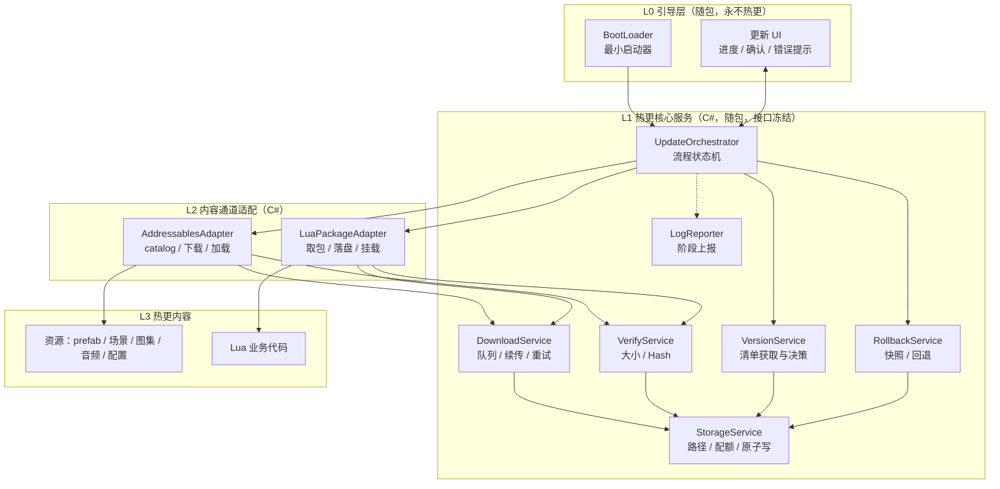
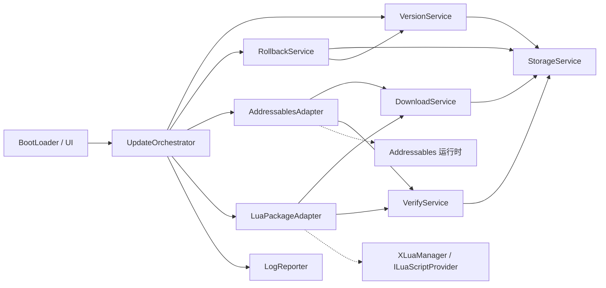
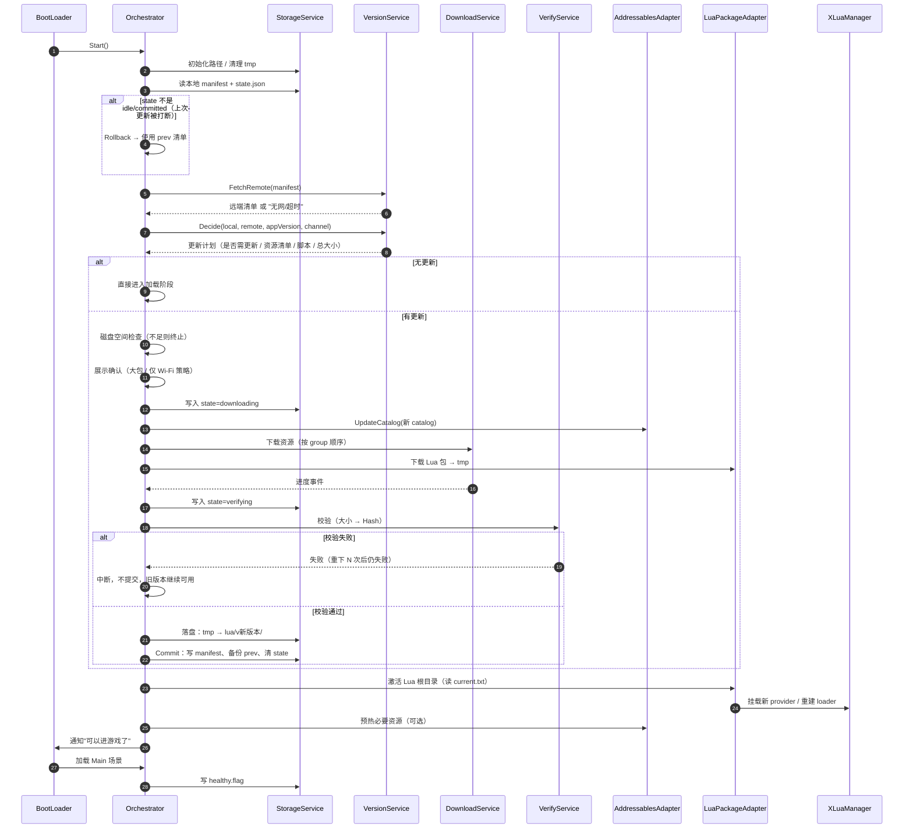
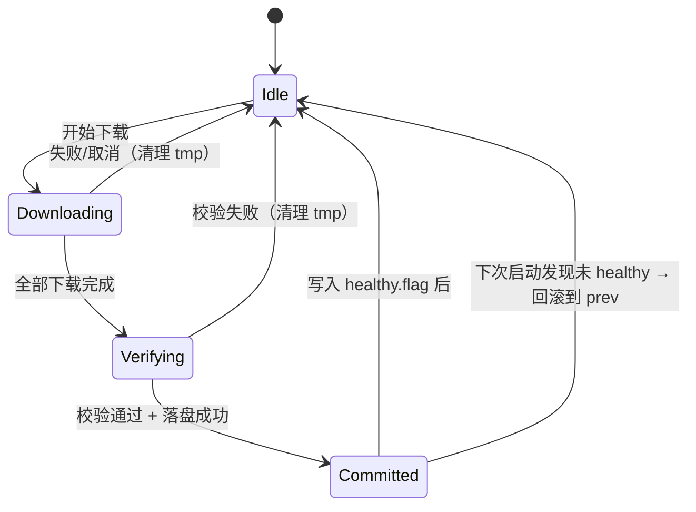

# 热更新系统架构设计

> 技术选型：Addressables（资源）+ xLua（代码）  
> 目标平台：Android / iOS / PC  
> 文档定位：团队共识文档。描述**模块划分与边界**，不包含业务实现细节。

**配套文档**

| 文档 | 用途 |
|---|---|
| [README.md](../README.md) | 使用手册：快速开始、配置项、常见任务、排查、错误码 |
| 本文 | 架构设计：为什么这样分层、模块边界、依赖规则、实施路线 |

---

## 0. 结论摘要

| 问题 | 结论 |
|---|---|
| 版本真相来源 | **自建 `manifest.json`**，不是 Addressables catalog 版本号 |
| 资源通道 | Addressables：远端 catalog + bundle，负责寻址、依赖解析、下载、CRC |
| 代码通道 | xLua + 单一 Lua 包（bundle），按版本整包替换，**不进 Addressables 依赖图** |
| 两者关系 | 互相不知道对方存在，**唯一交汇点是 manifest** |
| 回滚单位 | **整份清单回退**（资源 + 代码一起退），不做单文件回退 |
| 回滚实现 | 版本化目录 + 指针文件，不做 diff/patch |
| 不可热更的部分 | BootLoader、下载/校验服务、C# 暴露给 Lua 的接口签名 |
| 第一优先 | 清单模型 → 存储（原子写）→ 下载 → 校验 → Lua 通道端到端跑通 |

三条不可让步的纪律（后文展开）：

1. **C# 只做系统能力，业务逻辑写在 Lua**。写进 C# 的业务代码在发版后就永久固化了。
2. **不覆盖正在使用的文件**。新内容永远写到新目录，切换靠改指针。
3. **下载/校验失败绝不破坏已有可用版本**。宁可"这次没更成"，不能"更完之后打不开"。

---

## 1. 设计目标与约束

### 1.1 目标

| 目标 | 落地手段 |
|---|---|
| 稳定 | 原子提交、断点续传、失败可回滚、崩溃自愈 |
| 可维护 | 单一版本真相（manifest）、模块单向依赖、通道适配层隔离 |
| 可观测 | 每个阶段有明确状态与错误码，可上报 |
| 跨平台一致 | 所有 IO 走抽象层，StreamingAssets 一律按"只读 + 需 UnityWebRequest"处理 |

### 1.2 明确不做（避免过度设计）

- ❌ 不做二进制差分 / 增量 patch（首版整包替换，几 MB 的量级不值得）
- ❌ 不做灰度分流算法（只保留 manifest 里的一个灰度字段，由服务端决定给谁）
- ❌ 不做资产加密 / 防逆向着重（如有需求单独立项）
- ❌ 不做运行中热切换（Lua Reload 仅限开发期；发布版一律"启动时决策，加载后不换版本"）
- ❌ 不做多 CDN 智能调度（只做"主 + 备"两个 URL）
- ❌ 不自研 bundle 下载器去替代 Addressables 的依赖解析

---

## 2. 总体架构

### 2.1 分层



### 2.2 关键结构原则

- **L0/L1/L2 随包发布**，属于"不可热更区"。它们的职责一旦上线就冻结，因此必须**薄且稳**。
- **L3 是唯一的热更区**。判断一个需求该不该写进 C# 的标准：*"如果这段逻辑下周要改 bug，改了要不要重新发版？"* 要发版 → 必须放 L3。
- **L2 是适配层**，用来"换掉技术实现时不改 L1"。比如将来把 Addressables 换成自研 bundle 系统，只改 `AddressablesAdapter`。

---

## 3. 模块划分

### 3.1 逐个模块职责

| 模块 | 层 | 职责 | 明确不做 | 失败时行为 |
|---|---|---|---|---|
| **BootLoader** | L0 | 最早执行：环境自检（网络/磁盘/权限）、初始化路径、拉起 Orchestrator、渲染更新 UI、最后跳转游戏 | 不解析版本、不下载 | 弹错误页，提供"重试 / 退出" |
| **VersionService** | L1 | 拉取远端 manifest、与本地比对、产出"更新计划"（要不要更、更什么、多大） | 不下载、不落盘业务文件 | 远端失败 → 用本地清单继续启动（离线可玩） |
| **DownloadService** | L1 | 通用下载队列：并发控制、Range 续传、超时、指数退避重试、进度聚合 | 不知道内容语义（资源还是脚本） | 单任务重试 N 次后失败 → 整轮更新失败，旧版本继续可用 |
| **VerifyService** | L1 | 大小比对 → Hash 比对 → 签名（可选） | 不做修复，只判定 | 校验失败 → 删除该临时文件并重下一次 |
| **StorageService** | L1 | 路径约定、版本化目录、原子写入（临时文件 + rename）、磁盘配额检查与清理 | 不关心文件内容 | 空间不足 → 提前拦截并提示，不进入下载 |
| **RollbackService** | L1 | 维护 current / prev 双清单、事务状态、启动健康哨兵、执行回退 | 不负责重新下载 | 回退本身失败 → 走"内置版本"兜底 |
| **UpdateOrchestrator** | L1 | 流程状态机：串起上面所有模块，对外只暴露"启动更新"和"进度事件" | 不实现具体下载/校验逻辑 | 任一阶段异常 → 中断 → 回滚 |
| **AddressablesAdapter** | L2 | 加载远端 catalog、计算下载量、触发下载、对外提供资源加载入口 | 不决定"要不要更新" | 抛给 Orchestrator 统一处理 |
| **LuaPackageAdapter** | L2 | 取 Lua 包 → 落盘到版本目录 → 校验 → 通知 XLuaManager 换根目录 | 不解析 Lua 语义 | 同上 |
| **LogReporter** | L1 | 记录每阶段的版本、耗时、错误码，异步上报 | 不阻塞主流程 | 静默失败，不得影响启动 |

### 3.2 模块边界速查

- **"要不要更新"只由 VersionService 回答**。任何其他模块不得自己拉清单、自己比版本。
- **"文件怎么写"只由 StorageService 回答**。任何其他模块不得拼 `Application.persistentDataPath`。
- **"怎么下载"只由 DownloadService 回答**。适配层不得自己开 `UnityWebRequest`（Addressables 内部下载除外，那是它的封装）。
- **"现在到哪一步了"只由 Orchestrator 回答**。UI 只订阅它的事件，不反向驱动流程。

---

## 4. 模块依赖关系

### 4.1 依赖图（箭头 = 编译期引用）



### 4.2 依赖规则（评审 checklist）

| 规则 | 说明 |
|---|---|
| R1 | 依赖只允许**从上层指向下层**：L0 → L1 → L2 → L3，禁止反向 |
| R2 | L1 各服务之间**只允许极少数依赖**：`Download/Verify/Version/Rollback → Storage`，`Rollback → Version`，其余互不引用 |
| R3 | **L2 不得引用 Orchestrator**。适配层是被调用的，不是调用方 |
| R4 | **L1 不得引用具体适配器实现**，只引用接口（便于换实现、便于测试） |
| R5 | **L3 业务代码只能通过门面访问系统能力**，禁止直接调 DownloadService / Addressables |
| R6 | 所有跨模块通信走**显式事件或返回值**，不允许静态全局状态互相读 |
| R7 | 模块之间传递的数据只允许是**纯数据结构**（清单、计划、进度、错误），不传 `UnityWebRequest`、`AssetBundle` 之类的运行时对象（L2 内部除外） |

违反 R1/R3/R5 是最常见的腐化起点，需在 Code Review 中拦截。

---

## 5. Addressables 与 xLua 的职责边界

### 5.1 一张表看清分工

| 维度 | Addressables 负责 | xLua 负责 |
|---|---|---|
| 管理对象 | 资源：prefab、场景、图集、音频、SpriteAtlas、配置 SO | 逻辑：`.lua` 业务代码 |
| 版本单位 | catalog（含各 group 的 bundle 集合） | 一个 Lua 包（bundle） |
| 依赖解析 | **构建期静态分析**，运行时按 catalog 拉依赖 | **运行期 `require`**，动态、不可静态分析 |
| 下载单位 | bundle，可按 label 分组计算差异 | 整包（不拆分） |
| 完整性校验 | catalog hash + bundle **CRC**（内建能力） | 包级 Hash（自研，Addressables 不管） |
| 缓存管理 | `persistentDataPath/com.unity.addressables`，由它自己维护 | 版本化目录，由 StorageService 维护 |
| 加载接口 | `LoadAssetAsync` / `InstantiateAsync` | 自定义 `ILuaScriptProvider` ← 已有 |
| 回滚方式 | 重新加载旧 catalog（需保留旧 catalog 文件） | 指针切回旧版本目录 |

### 5.2 边界判定原则

> **资源用 Addressables 的"寻址"，代码用 Lua 的"require"。两者都只认 manifest 给出的版本号，彼此解耦。**

具体到三条硬规则：

1. **Lua 包不进 Addressables 的依赖图。**
   原因：Addressables 的依赖是构建期算出来的，而 Lua 的 `require` 是运行期的。把 Lua 塞进 Addressables group 会得到一个"看起来能跑、但依赖关系是错的"系统 —— 少打一个 Lua 文件，构建期不会报错，运行期才炸。
   → Lua 包由 manifest 直接指向，独立下载、独立版本、独立回滚。

2. **校验不重复造轮子。**
   资源侧用 Addressables 内建的 catalog hash + bundle CRC；只有 Lua 包需要我们自己算 Hash（因为它不在 Addressables 体系内）。**不要**再给每个 bundle 单独写一套 hash 校验，那是重复投入且容易和 Addressables 的缓存逻辑打架。

3. **不要手动删 Addressables 的缓存目录。**
   清理只能走 `Addressables.ClearDependencyCacheAsync`。直接删目录会导致 catalog 与实际文件不一致，属于"偶现加载失败"的头号来源。

### 5.3 xLua 的真实边界（团队必须知道）

xLua **不是万能的代码热更**，边界如下：

| 能热更 | 不能热更 |
|---|---|
| Lua 业务逻辑、UI 流程、数值、配置驱动逻辑 | C# 类型的**结构变更**（加字段/改继承） |
| Lua 侧新增模块、改 bug | C# 侧新增/修改供 Lua 调用的 API 签名 |
| 资源加载策略（在 Lua 层） | iOS 上新增 `[CSharpCallLua]` / `[LuaCallCSharp]` 生成代码（需重新出包） |
| Lua 层新增对外接口 | 已发布 Player 里的任何 C# 行为 |

**推论（架构纪律）**：
- C# 只放"系统能力 + 平台能力"，且**尽量一次性设计到位**。
- 给 Lua 的 C# 接口要**少、稳、泛化**（宁可一个 `Call(service, method, args)` 的通用入口，也不要每天新增一个强类型方法）。
- xLua 生成代码（gen）必须进版本控制，且**每次出包前重新生成**，否则会出现"编辑器能跑、真机报错"。

---

## 6. 版本模型与清单

### 6.1 三级版本

| 版本 | 谁产生 | 作用 |
|---|---|---|
| **AppVersion** | 玩家安装包（商店） | 决定能兼容哪些 manifest；不兼容 → 引导去商店 |
| **ResourceVersion** | 每次构建 Addressables 产出 | 标识一套 catalog + bundle 集合 |
| **ScriptVersion** | 每次构建 Lua 包产出 | 标识一个 Lua 包 |

外加一个**单调递增的 `contentVersion`（整数）**，作为"是否有更新"的唯一比较依据。
不要用时间戳、不要用语义化版本比较大小 —— 整数最不容易出错。

### 6.2 manifest 内容（结构说明，非代码）

```text
manifest
├─ manifestVersion          清单格式版本（用于将来兼容老客户端）
├─ contentVersion           整数，单调递增；客户端的"是否要更新"只看它
├─ appVersionRange          兼容区间 { min, max }；越界则强制走商店
├─ resources
│   ├─ catalogUrl           远端 catalog 地址
│   ├─ catalogHash          用于判断 catalog 是否变化
│   └─ groups[]             { name, version, size, hash }（用于分模块按需下载）
├─ scripts
│   ├─ packageUrl           Lua 包地址
│   ├─ packageHash          包级 Hash
│   ├─ size                 用于提前判断流量/磁盘
│   └─ entryModule          入口模块名（默认 "Main"，替换 XLuaManager 的硬编码）
├─ channel                  灰度/渠道标记
└─ createdAt                发布时刻（仅用于排查，不参与比较）
```

### 6.3 清单的存放与获取

| 位置 | 用途 |
|---|---|
| 包内 `StreamingAssets/hotfix/manifest.json` | 出厂基线，**离线可用**、**回滚兜底** |
| 本地 `persistentDataPath/hotfix/manifest.json` | 当前生效版本 |
| 本地 `persistentDataPath/hotfix/manifest.prev.json` | 上一版，用于回滚 |
| 远端 CDN | 最新版本 |

**获取策略**：先请求远端（带 `If-None-Match` / ETag）；网络失败或超时 → 直接用本地清单启动游戏，后台静默重试。**永远不要因为"检查不到更新"而卡住玩家**。

---

## 7. 目录结构

### 7.1 工程目录（源）

```text
HotFixProject/
├─ Assets/
│  ├─ Scenes/
│  │  ├─ Boot.unity                  # 唯一入口场景，只放 BootLoader
│  │  └─ Main.unity                  # 业务场景
│  ├─ Scripts/
│  │  ├─ Hotfix/                     # 热更系统（随包，职责冻结）
│  │  │  ├─ README.md                # 使用手册（快速开始 / 配置 / 排查），与代码同目录
│  │  │  ├─ LICENSE                  # MIT 许可（本目录可作为独立仓库根）
│  │  │  ├─ .gitignore               # 独立仓库根时的忽略规则
│  │  │  ├─ Docs/
│  │  │  │  └─ HotUpdateArchitecture.md   # 本文档：架构与边界
│  │  │  ├─ Bootstrap/               # L0：不可热更 · BootLoader
│  │  │  ├─ Core/                    # 编排、状态、配置、路径、存储、配额、上报
│  │  │  ├─ Version/                 # 清单模型 + 版本决策
│  │  │  ├─ Download/                # 断点续传下载器
│  │  │  ├─ Verify/                  # 大小 + SHA256
│  │  │  ├─ Rollback/                # 事务与回退
│  │  │  ├─ Adapters/                # Lua 通道 + Addressables 通道
│  │  │  ├─ XLuaMgr/                 # 运行时：XLuaManager / LuaScriptLoader / LuaErrorInfo
│  │  │  │  └─ README.md             # 管理器使用说明
│  │  │  └─ Editor/                  # 仅编辑器，按归属分子目录
│  │  │     ├─ Hotfix/               # 构建工具 + 构建配置
│  │  │     └─ XLuaMgr/              # Lua→Text 转换、示例脚本生成
│  │  └─ Runtime/                    # 场景胶水（保持极薄）
│  ├─ ArtAssets/
│  │  ├─ Config/                     # 远端配置（remote_config 资源组的源）
│  │  └─ Lua/                        # 由 Lua 源转换出的 .lua.txt（打 Lua 包用）
│  ├─ Settings/
│  │  └─ HotfixBuildSettings.asset   # 构建期配置（首次构建自动生成）
│  ├─ AddressableAssetsData/         # Addressables 配置；远端组由构建工具自动创建
│  ├─ StreamingAssets/
│  │  └─ hotfix/
│  │     ├─ manifest.json            # 出厂基线清单
│  │     └─ lua.bundle               # 出厂 Lua 包（兜底用）
│  └─ XLua/                          # 第三方，不改动
├─ Lua/                              # Lua 源码（独立管理，便于 IDE 提示与代码审查）
│  ├─ Main.lua
│  ├─ core/                          # 框架层（事件、UI 栈、资源封装、日志）
│  ├─ modules/                       # 业务模块
│  └─ config/
├─ ServerData/
│  └─ hotfix/                        # 构建产物（上传 CDN 的源）
│     ├─ manifest.json
│     ├─ lua-<版本>.bundle
│     └─ aa/<平台>/catalog* + 资源 bundle
└─ ProjectSettings/
```

**几条目录约定**：
- `Assets/ArtAssets/` 下**一层子目录 = 一个资源单元**。远端组名与目录名保持一致，让人一眼能对上。
- `Lua/` 放在**工程根目录而非 Assets 下**：不参与 Unity 资产导入，改脚本不会触发重编译/重导入，迭代快；由构建工具转成 `.lua.txt` 后再进 Assets。
- `Hotfix/Bootstrap/` 与 `Hotfix/` 其余目录的区别是**生命周期**，不是功能。任何"下周可能要改"的代码都不许放进 Bootstrap。
- `Settings/` 与 `ServerData/` 都是**生成物**：前者首次构建时创建，后者每次构建覆盖，不需要手工维护。
- 文档跟着代码走：`README.md` 与 `Docs/` 都放在 `Assets/Scripts/Hotfix/` 下（工程根已无 `Docs/` 目录），文档之间的引用按这个相对位置写；模块整体搬迁时文档随目录一起移动即可。
- `XLuaMgr/`（运行时）与 `Editor/XLuaMgr/`（工具）已并入 `Hotfix/`：前者仍是 Lua 运行时能力，后者是仅编辑器脚本，全工程的编辑器代码集中在 `Hotfix/Editor/` 一个目录下，按归属分子目录。

### 7.2 运行时目录（`persistentDataPath`）

```text
persistentDataPath/
├─ hotfix/
│  ├─ manifest.json              # 当前生效
│  ├─ manifest.prev.json         # 上一版（回滚用）
│  ├─ state.json                 # 事务状态：idle / downloading / verifying / committed
│  ├─ healthy.flag               # 健康哨兵：写完代表本次启动成功
│  ├─ lua/
│  │  ├─ v1.0.3/
│  │  │  └─ lua.bundle
│  │  ├─ v1.0.4/
│  │  │  └─ lua.bundle
│  │  └─ current.txt             # 内容就是一行版本号，例："v1.0.4"
│  └─ tmp/                       # 下载临时区，启动时清空
└─ com.unity.addressables/       # Addressables 自己管，不要手删
```

**为什么是"版本化目录 + 指针"而不是"覆盖更新"**：
- 覆盖 = 一旦新版本有问题，旧文件已经被破坏，无法回滚。
- 版本化目录 = 回滚成本是改一行文本，最坏情况也只是多占一份空间。

Android/iOS 对符号链接支持不一致，所以指针用**普通文本文件记录版本号**，不用软链。

---

## 8. 完整热更流程

### 8.1 时序



### 8.2 阶段表（含失败处理）

| # | 阶段 | 关键动作 | 失败处理 | 能否卡住玩家 |
|---|---|---|---|---|
| 0 | 环境自检 | 网络类型、磁盘余量、路径可写、权限 | 磁盘不足 → 提示清理，不进下载 | 是（磁盘满无法继续） |
| 1 | 本地恢复 | 读 manifest + state；上次事务未提交 → 回滚 | 本地清单损坏 → 用 StreamingAssets 内置清单 | 否 |
| 2 | 拉取清单 | 远端请求，ETag 缓存，3~5s 超时 | 超时/失败 → 用本地清单直接启动 | **否**（必须保证） |
| 3 | 版本决策 | 比 contentVersion、查 appVersionRange、查灰度 | 需强更 → 引导商店；其余情况用本地版本 | 强更是 |
| 4 | 空间预检 | 新内容大小 + 保留旧版本 × 2 | 不足 → 提示清理或降级为"仅更脚本" | 是 |
| 5 | 下载 | 并发 3、Range 续传、单文件超时 30s、退避重试 3 次 | 超限 → 整轮失败，保留旧版本 | 否（可跳过继续玩） |
| 6 | 校验 | 大小 → Hash；资源侧用 Addressables CRC | 单个失败重下；连续失败 → 终止本轮 | 否 |
| 7 | 落盘 | tmp → 版本目录（同盘 rename） | 失败 → 清理 tmp，保留旧版本 | 否 |
| 8 | 提交 | 写 manifest → 备份 prev → 清 state | 失败 → 下次启动按"未提交"回滚 | 否 |
| 9 | 加载 | 激活 Lua 根目录，加载 catalog，进 Main | 加载异常 → 弹错误 + 上报，允许重试 | 是 |
| 10 | 健康标记 | 进游戏后写 healthy.flag | 未写 → 下次启动自动回滚 | — |

### 8.3 状态机（`state.json` 的 phase）



`Downloading` / `Verifying` 是**中间态**。启动时若发现停在这两个状态，说明上次进程异常退出，一律按"未提交"处理 —— 这是最简单也最可靠的自愈规则。

---

## 9. 回滚设计

### 9.1 回滚触发条件

| 条件 | 处理 |
|---|---|
| 启动时 `state.phase` 是 `downloading` / `verifying` | 回退到 prev 清单 |
| 连续 2 次启动未写入 `healthy.flag` | 回退到 prev 清单，并标记该版本"坏版本"，不再尝试下载 |
| 玩家手动"修复客户端" | 回退到 prev → 仍失败 → 回退到 StreamingAssets 内置版本 |
| manifest 解析失败 / 版本目录缺失 | 逐级降级：prev → 内置 |

### 9.2 回滚单位与保留策略

- **整清单回退**：`contentVersion` 回到上一版，资源 catalog 与 Lua 包一起退。  
  不做"只回滚 Lua"或"只回滚某个资源"——那会让版本组合爆炸，调试成本远高于收益。
- **保留版本数 = 2**（当前 + 上一版）。旧版本在提交新版本**之后**才清理，保证任何时刻都有一份"确定可用"的版本。
- 资源侧回滚需要**保留旧 catalog 文件**。manifest 里存的是 catalog 的完整文件名，回滚时按文件名加载旧 catalog，而不是"加载最新"。

### 9.3 兜底顺序

```text
本地 current ──失败→ prev ──失败→ StreamingAssets 内置 ──失败→ 提示重装
```

任何一层成功即可进入游戏。这条链条必须在首次发布前就打通，不能等出事故再补。

---

## 10. 平台差异与合规

| 平台 | 关键差异 | 处理方式 |
|---|---|---|
| **Android** | `StreamingAssets` 在 APK 内，**不能用 `File.ReadAllBytes`** | 统一走 `UnityWebRequest` 读 StreamingAssets；现有 `FileSystemLuaProvider` 需注意此分支 |
| **Android** | `persistentDataPath` 可写；外部存储权限非必需 | 不使用外部存储，避免权限弹窗与门店审核问题 |
| **iOS** | 禁止 JIT，但 Lua 解释器本身可用 | Lua 代码热更合规；`xlua.gen` 必须随包，不能运行时生成 |
| **iOS** | 审核：不得下发可执行原生代码 | **只能下发 Lua 脚本与资源**。禁止在 Lua 包里夹带 dll/so/framework |
| **iOS** | `StreamingAssets` 同样需 WebRequest 读 | 同上 |
| **PC** | 可写、可直接读文件 | 保留 `FileSystemLuaProvider` 的快速路径，开发期体验最好 |
| **三平台** | 编码/换行差异 | Lua 源统一 UTF-8 无 BOM，`.lua.txt` 转换必须在 CI 里做，不要依赖本地手工操作 |

**合规红线（写进发布 checklist）**：
1. 热更内容只包含资源与 Lua 脚本，不得包含任何原生可执行文件。
2. 不得利用热更绕过商店审核上架新功能（审核口径以"修复 bug / 内容更新"为准，重大功能更新应走商店）。
3. 首次启动的强制更新必须有明确提示，不得静默消耗大量流量。

---

## 11. 实施路线（优先级）

### P0 —— 必须先做（没有它系统不成立）

| 顺序 | 模块 | 理由 |
|---|---|---|
| 1 | **manifest 数据模型 + StorageService 路径/原子写** | 所有模块都依赖它；先定契约，后面才能并行 |
| 2 | **DownloadService（含续传、重试、超时）** | 唯一真正"难写对"的部分，也最容易线上出事故 |
| 3 | **VerifyService（大小 + Hash）** | 没有校验的下载系统等于没有热更 |
| 4 | **顶部状态机 + 最小更新 UI** | 需要它把各模块串起来才能端到端验证 |
| 5 | **Lua 通道端到端** | 没有 catalog 依赖，链路最短，**用它来验证整套地基** |
| 6 | **回滚（双清单 + state.json + 健康哨兵）** | 必须和第一版一起上线，不能"以后再加" |

> P0 的验收标准：**能对 Lua 包做一次真实更新，并成功回滚一次**。这两件事都跑通，架构就立住了。

### P1 —— 第二梯队（打通资源通道 + 体验）

| 顺序 | 模块 | 理由 |
|---|---|---|
| 7 | **AddressablesAdapter：远端 catalog 接入** | 依赖 P0 的下载/校验地基，此时接入成本最低 |
| 8 | **资源分组（local/remote）与按需下载** | 决定包体与流量体验，需要真实资源量级才能定 group 粒度 |
| 9 | **磁盘配额与旧版本清理** | 有真实数据后再定策略，过早设计容易定错阈值 |
| 10 | **LogReporter / 错误码体系** | 有线上数据后才有意义 |
| 11 | **强更 / 可选更 / 仅 Wi-Fi 策略** | 属于产品策略，可后置 |

### P2 —— 有明确需求再做

| 模块 | 触发条件 |
|---|---|
| 分 group 的边玩边下（场景级流式） | 包体大到"必须下载完才能玩"不可接受时 |
| 灰度 / AB 实验分流 | 服务端有分流能力且运营有需求时 |
| 增量/差分更新 | Lua 包或资源包大到几百 MB 量级时 |
| 包体加密 | 有明确资产保护诉求时（且需评估包体与加载耗时代价） |
| 多 CDN 调度 | 单 CDN 出现可观测的地域性失败时 |

**排序逻辑**：先打通"一条完整链路"，再上"第二条通道"，最后才做"优化与运营能力"。反过来做（先做灰度、先做差分）通常会在核心链路还不稳的情况下引入无法定位的问题。

---

## 12. 落地状态（P0 已实现）

### 12.1 已实现的模块

| 模块 | 位置 | 说明 |
|---|---|---|
| 路径约定 | `Assets/Scripts/Hotfix/Core/HotfixPaths.cs` | 运行时目录的唯一出处，其他模块不得自己拼路径 |
| 存储 / 原子写 | `Assets/Scripts/Hotfix/Core/StorageService.cs` | 临时文件 + 改名；包内文件统一走 UnityWebRequest |
| 配置 | `Assets/Scripts/Hotfix/Core/HotfixConfig.cs` | 挂在 BootLoader 上，不写死在代码里 |
| 事务状态 | `Assets/Scripts/Hotfix/Core/HotfixState.cs` | phase / bootAttempts / badContentVersion |
| 清单模型 | `Assets/Scripts/Hotfix/Version/HotfixManifest.cs` | 含 BOM 清洗（CDN 常带 BOM，JsonUtility 会直接失败） |
| 版本服务 | `Assets/Scripts/Hotfix/Version/ManifestService.cs` | 本地 → 内置 → 远端；清单拉取带重试与退避 |
| 下载器 | `Assets/Scripts/Hotfix/Download/DownloadService.cs` | Range 续传、超时、指数退避；识别服务器忽略 Range 并自动重下 |
| 校验 | `Assets/Scripts/Hotfix/Verify/VerifyService.cs` | 大小 + SHA256，按块读取不卡主线程 |
| Lua 通道 | `Assets/Scripts/Hotfix/Adapters/LuaPackageAdapter.cs` | 下载 / 校验 / 落盘 / 激活四步分离，出厂基线释放 |
| 回滚 | `Assets/Scripts/Hotfix/Rollback/RollbackService.cs` | 双清单、state.json、健康哨兵、坏版本标记 |
| 编排 | `Assets/Scripts/Hotfix/Core/UpdateOrchestrator.cs` | 唯一流程入口，UI 只订阅进度 |
| 引导 | `Assets/Scripts/Hotfix/Bootstrap/BootLoader.cs` | IMGUI 占位 UI；跑完更新才创建 XLuaManager |
| 构建工具 | `Assets/Scripts/Hotfix/Editor/Hotfix/HotfixBuildTools.cs` | Lua→Text 转换、打 bundle、算 Hash、生成清单、释放基线 |
| 构建配置 | `Assets/Scripts/Hotfix/Editor/Hotfix/HotfixBuildSettings.cs` | 资产位于 `Assets/Settings/HotfixBuildSettings.asset` |
| 资源通道（P1） | `Assets/Scripts/Hotfix/Adapters/AddressablesAdapter.cs` | 远端 catalog 加载、按 label 查询下载量、下载依赖、缓存清理 |
| 空间配额（P1） | `Assets/Scripts/Hotfix/Core/StorageQuotaService.cs` | 空间预检（预留 32MB）、旧版本清理（保留当前+上一版） |
| 上报（P1） | `Assets/Scripts/Hotfix/Core/HotfixReporter.cs` | `IHotfixReporter` + 阶段耗时；默认只打日志 |

对 `XLuaManager` 的改动只有三类（其余加载逻辑原样复用）：
`SuppressAutoCreate` / `PendingLuaRoot` / `PendingSuppressAutoRunMain` 三个静态入口、
`SetLuaRootOverride()` 运行时换根目录、以及目录内存在 `lua.bundle` 时自动挂载。

### 12.2 日常使用

| 场景 | 操作 |
|---|---|
| 首次接入 | 菜单 `Tools/Hotfix/1. Create Build Settings` 生成配置资产 |
| 发布热更 | 菜单 `Tools/Hotfix/2. Build Lua Package + Manifest`（会自动递增 contentVersion） |
| 创建引导场景 | 菜单 `Tools/Hotfix/3. Create Boot Scene`（Boot 已创建并排在 Build Settings 第一位，其余场景自动补入） |
| 命令行 | `Unity.exe -batchmode -quit -projectPath <工程> -executeMethod HotFix.HotUpdate.EditorTools.HotfixBuildTools.BuildFromCommandLine` |
| 开发期改 Lua | 直接改 `Lua/` 下的脚本，Play 即可（Editor 下 Debug 模式优先读工程目录） |

发布时把 `ServerData/hotfix/` 整个上传到 CDN，并把 `HotfixConfig.manifestUrl` 指向它。
完整的部署、验证、排查步骤见 [../README.md](../README.md)。

### 12.3 已验证内容

| 验证项 | 方式 | 结果 |
|---|---|---|
| 运行时 + 编辑器脚本编译 | Unity 2022.3.48f1c1 实机编译 | 0 error |
| 构建工具产出 | 实际执行构建 | `lua-1.0.1.bundle` + `manifest.json`，Hash 独立复算一致 |
| 出厂基线 | 构建后检查 | `Assets/StreamingAssets/hotfix/{manifest.json,lua.bundle}` |
| 全新安装 → 更新 | 本地 HTTP 充当 CDN，跑真实流程 | 下载 → 校验 → 落到 `lua/v1.0.2` → 提交，contentVersion 1 → 2 |
| 事务中断 → 恢复 | 注入 `state.phase=downloading` 后重启流程 | 回退到基线并重新更新成功，旧版本目录保留 |
| Addressables 构建 | 实际执行构建 | 产出 `aa/<平台>/{catalog.json,catalog.hash}` + 资源 bundle，清单 `resources` 正确回填 |
| 远端 catalog 加载 | 本地 HTTP 加载 catalog | `catalog ok=True`；`GetDownloadSizeAsync(label)` 返回真实字节数 |

验证过程中修掉的真实缺陷：JSON BOM 解析失败、回退到内置基线时的空引用、
清单拉取缺少重试、`AssetDatabase.Refresh` 后持有失效 ScriptableObject 引用、
`AddressablesPlayerBuildResult.OutputPath` 指向 `settings.json` 而非内容目录、catalog 未被搬到上传目录。

### 12.4 P1 已实现

| 能力 | 实现要点 |
|---|---|
| Addressables 资源通道 | 清单 `resources.catalogUrl` → `LoadContentCatalogAsync` → 按 group 名当 label → `GetDownloadSizeAsync` 算量 → `DownloadDependenciesAsync` 下载。CRC 与缓存全部交给 Addressables |
| 资源构建 | 构建工具自动建远端组、设置 RemoteBuildPath/LoadPath、按目录标 addressable、打 label，构建后把 `catalog*` 搬到 `ServerData/hotfix/aa/<平台>/` 并回填清单 |
| 空间预检 | 下载前检查 `可用空间 - 32MB >= 待下载 + 旧版本占用`，不足直接失败且不破坏现有版本 |
| 旧版本清理 | 只保留当前 + 上一版；清理走版本目录删除，不做手动删 Addressables 缓存 |
| 网络策略 | 移动网络下超过阈值默认跳过（继续用旧内容，不算失败）；超过确认阈值时挂起流程等玩家确认 |
| 上报 | 每个阶段有耗时，结束产出 `UpdateResult` + 阶段序列；实现 `IHotfixReporter` 即可接真实埋点 |

**未做「自建下载并发队列」**：资源下载已由 Addressables 负责，自有通道目前只有一个 Lua 包，
加并发只会变成没人调用的死代码。等 Lua 拆包（core + 模块）时再补，届时队列才有意义。

### 12.5 尚未实现（P2）

| 缺口 | 说明 |
|---|---|
| 灰度 / AB 分流 | 清单里已预留 `channel`，服务端按用户分流下发不同清单即可，客户端暂不需要改 |
| 差量更新 | 需要真实包体规模数据后再评估 |
| 正式 uGUI / UI Toolkit 界面 | 当前 IMGUI 仅占位，替换时只改 BootLoader，流程不动 |
| 包体加密 / 多 CDN 调度 | 有明确诉求再立项 |


---

## 13. 反模式清单（Code Review 拦截项）

| # | 反模式 | 后果 | 正确做法 |
|---|---|---|---|
| 1 | 把 Lua 包放进 Addressables 依赖图 | 构建期不报错、运行期缺文件 | Lua 包独立由 manifest 指向 |
| 2 | 用 catalog 版本号当唯一版本真相 | 无法统一回滚代码与资源 | manifest 是唯一真相 |
| 3 | 下载直接覆盖现有文件 | 更新失败即不可玩 | 版本化目录 + 原子提交 |
| 4 | 业务逻辑写进 C# | 出 bug 必须重新发版 | C# 只做系统能力 |
| 5 | 检查更新失败就卡住/退出 | 弱网玩家进不去游戏 | 失败用本地清单静默降级 |
| 6 | 手删 `com.unity.addressables` 缓存目录 | catalog 与实际文件不一致，偶现加载失败 | 用 `ClearDependencyCacheAsync` |
| 7 | `File.ReadAllBytes(StreamingAssets/...)` | Android 直接崩 | 统一走 UnityWebRequest |
| 8 | UI 直接调用下载器/校验器 | 流程不可测、无法回滚 | 只经由 Orchestrator |
| 9 | 各模块自己拼 `persistentDataPath` | 路径漂移，清理漏文件 | 统一走 StorageService |
| 10 | 忘了重新生成 xLua 代码就出包 | 编辑器正常、真机报错 | 出包流水线强制 gen |
| 11 | 回滚只回滚一半（只退资源或只退脚本） | 版本组合爆炸，难复现 | 整清单回退 |
| 12 | 用软链接做版本指针 | Android/iOS 行为不一致 | 用文本文件记录版本号 |

---

## 14. 待团队决策项

以下问题需要结合产品与运维情况确认，本文档给了默认建议：

| 议题 | 默认建议 | 影响 |
|---|---|---|
| CDN 与流量成本 | 先单 CDN + 备用域名，资源走压缩 + CRC | 决定 group 粒度与首包大小 |
| 首包内容边界 | 首包只放"能进游戏的最小集合"，其余远端 | 直接影响首次启动体验 |
| Lua 包格式 | **AssetBundle**（复用现有 `AssetBundleLuaProvider`，零新代码） | 若将来需要明文可视/差分再评估 zip |
| 大包确认阈值 | 超过 50MB 弹确认，超过 200MB 强制 Wi-Fi | 产品策略，可配 |
| 强更判定 | 只由 `appVersionRange` 判定，不做"服务端强制" | 规则越少越不容易误杀 |
| 开发期是否跳过更新流程 | Debug 模式下默认跳过，可手动开启 | 影响日常迭代效率 |

---

## 附录 A：术语表

| 术语 | 含义 |
|---|---|
| **Manifest** | 自建版本清单，系统唯一的版本真相 |
| **contentVersion** | 单调递增整数，判断"是否有更新"的唯一依据 |
| **Lua 包** | 一次构建产出的全部 Lua 脚本，作为不可分割的整体发布 |
| **版本化目录** | 每个版本独占一个目录，互不覆盖 |
| **指针** | 记录"当前使用哪个版本"的文本文件 |
| **提交（Commit）** | 把新版本从"已下载"变为"生效"的原子动作 |
| **健康哨兵** | 启动成功后才写的标记文件，用于判定是否需要自动回滚 |
| **中间态** | `downloading` / `verifying`，启动时遇到即视为异常退出 |

## 附录 B：发布 Checklist

- [ ] xLua 生成代码已重新 gen 并提交
- [ ] 执行 `Tools/Hotfix/2. Build Lua Package + Manifest`（自动完成 Lua→Text 转换、打 bundle、算 Hash、写清单、更新出厂基线）
- [ ] `ServerData/hotfix/manifest.json` 的 `contentVersion` 已递增，`packageUrl` 指向真实 CDN 域名
- [ ] `HotfixConfig.manifestUrl` 已配置为 CDN 上的清单地址
- [ ] `Assets/StreamingAssets/hotfix/` 已随包（新装用户的出厂基线）
- [ ] 把 `ServerData/hotfix/` 全量上传到 CDN（含 `aa/<平台>/catalog*`），并确认目录可匿名读取
- [ ] `HotfixBuildSettings.includeAddressables` 开启时，确认清单里 `resources.catalogUrl` 指向真实域名
- [ ] 该 bundle 是按目标平台构建的（bundle 与平台绑定，多平台需各自构建）
- [ ] 上传后在**真机**上验证：全新安装 → 检查更新 → 下载 → 校验 → 进游戏
- [ ] 验证回滚：手工改坏一个文件后启动，确认能退到 prev
- [ ] iOS 包已确认不包含任何原生可执行文件
- [ ] 资源更新时，`aa/<平台>/` 下的 `catalog.json`、`catalog.hash`、资源 bundle 是**同一次构建**的产物
