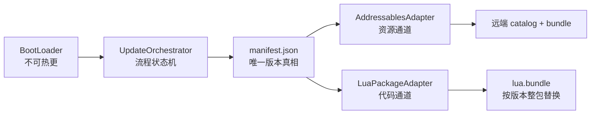

# Hotfix 热更新系统 · README

> 资源走 Addressables，代码走 xLua，自建 `manifest.json` 作为唯一版本真相。
> 平台：Android / iOS / PC（Unity 2022.3.48f1c1）
>
> 状态：P0（版本 / 下载 / 校验 / 回滚 / Lua 通道）+ P1（资源通道 / 配额 / 策略 / 上报）已落地。
> 只想接进现有工程：直接看 **§2 快速导入**；设计与取舍理由见 [Docs/HotUpdateArchitecture.md](./Docs/HotUpdateArchitecture.md)。

---

## 1. 30 秒理解



两条通道**互不认识**，只认清单给的版本号：

| 通道 | 管什么 | 版本单位 | 校验 |
|---|---|---|---|
| Addressables | prefab / 场景 / 图集 / 配置等资源 | catalog + 资源组 | catalog hash + bundle CRC（Addressables 内建） |
| xLua | `.lua` 业务逻辑 | 一个 Lua 包 | 包级 SHA256（自研） |

> 一条纪律：**C# 只放系统能力，业务逻辑写在 Lua**。写进 C# 的业务代码发版后就固化了。

---

## 2. 快速导入（独立仓库 → 已有工程）

本仓库的内容 = 工程里的 `Assets/Scripts/Hotfix/` 目录：**不含** Unity 工程文件，也**不含**第三方 xLua。

### 2.1 前置条件

| 项 | 要求 | 说明 |
|---|---|---|
| Unity | 2022.3.48f1c1 | 同系列 2022.3 LTS 一般可用，未逐版验证 |
| Addressables | `com.unity.addressables` 1.22.x（验证于 1.22.3） | Package Manager 安装；不装会编译失败 |
| xLua | 腾讯 xLua 完整目录（`Src` / `Plugins` / `Editor`） | 自行引入到 `Assets/XLua/`，本仓库不含 |
| Lua 入口 | `<工程根>/Lua/Main.lua` | 开发期调试与构建转换的源；`entryModule` 默认 `Main` |

### 2.2 拷贝

```text
你的工程/
├─ Assets/
│  ├─ XLua/                      ← 自行引入（第三方）
│  └─ Scripts/Hotfix/            ← 本仓库全部内容
└─ Lua/Main.lua                  ← 入口脚本
```

- **`.meta` 一起拷**：脚本 GUID 变化会让已挂好的组件引用丢失。
- `Editor/` 目录名不能改（`Assets/Scripts/Hotfix/Editor/` 及其子目录都满足），否则编辑器脚本会被打进包体，运行时编译失败。
- 运行时代码没有硬编码路径，放别的目录也能跑；构建工具则会写到固定位置——配置资产 `Assets/Settings/HotfixBuildSettings.asset`、Boot 场景 `Assets/Scenes/Boot.unity`，Lua 文本输出目录由 `luaAssetFolder` 决定（默认 `Assets/ArtAssets/Lua`），目录不存在会自动创建。

### 2.3 四步接入

1. **准备入口脚本**：`Tools/XLua/创建示例脚本 Lua/Main.lua`（已有入口可跳过）；发布前执行一次 `XLua/Generate Code`。不生成也能跑，但 `XLuaManager` 会走反射，性能差且不支持委托类型。
2. **生成构建配置**：`Tools/Hotfix/1. Create Build Settings` → `Assets/Settings/HotfixBuildSettings.asset`，把 `cdnBaseUrl` 改成自己的 CDN 前缀（本地联调可用 `http://127.0.0.1:8118`）。Addressables 无需手动初始化，构建时会自动建 settings 与远端组。
3. **构建产物**：`Tools/Hotfix/2. Build Lua Package + Manifest` → `ServerData/hotfix/`（上传 CDN）+ `Assets/StreamingAssets/hotfix/`（出厂基线）。
4. **创建引导场景**：`Tools/Hotfix/3. Create Boot Scene` → 生成 `Assets/Scenes/Boot.unity`，保证它排在 Build Settings 第一位，并把 `Assets/Scenes` 下其他场景自动补入。

### 2.4 首次运行

打开 `Boot.unity`，选中 `Boot` 物体，在 `BootLoader` 的 `config` 里填：

| 字段 | 填法 |
|---|---|
| `manifestUrl` | 先留空验证内置基线；或填清单地址，如 `http://127.0.0.1:8118/manifest.json` |
| `mainSceneName` | 更新后要进的场景名，必须在 Build Settings 里（默认 `Main`） |

Play 后 Console 出现 `[Hotfix] 更新完成: ...` 与 `[XLua] ...` 即接入成功。配置项见 [§5](#5-配置项)，本地模拟 CDN 见 [§7.3](#73-本地模拟热更不碰真-cdn)。

> 只想先打通 Lua 通道：把 `HotfixConfig.enableAddressablesChannel` 与构建配置的 `includeAddressables` 都关掉，就不再构建/下载资源包（Addressables 包本身仍需安装，代码编译依赖它）。

---

## 3. 快速开始

### 3.1 场景准备

| 场景 | 内容 |
|---|---|
| `Assets/Scenes/Boot.unity` | 只放 `BootLoader`，**不要放 XLuaManager** |
| `Assets/Scenes/Main.unity` | 业务场景 |

两个场景都必须在 Build Settings 里，Boot 排第一。
菜单 `Tools/Hotfix/3. Create Boot Scene` 会自动创建 Boot 场景并把 `Assets/Scenes` 下的场景补进 Build Settings。

### 3.2 配置

选中 Boot 场景里的 `Boot` 物体，在 `BootLoader` 上填：

| 字段 | 说明 |
|---|---|
| `manifestUrl` | CDN 上的清单地址，例如 `https://cdn.example.com/hotfix/manifest.json`；留空则只跑本地/内置版本 |
| `mainSceneName` | 更新完成后加载的场景名，默认 `Main` |

网络策略、超时、重试等在同一组件的 `HotfixConfig` 里，见 [§5](#5-配置项)。

### 3.3 构建

首次执行 `Tools/Hotfix/1. Create Build Settings` 生成 `Assets/Settings/HotfixBuildSettings.asset`，
把 `cdnBaseUrl` 改成你自己的 CDN 地址，然后执行 **`Tools/Hotfix/2. Build Lua Package + Manifest`**。
（直接执行第 2 步也可以，配置资产不存在时会自动创建。）

一次构建会完成：

1. `Lua/` → `Assets/ArtAssets/Lua/*.lua.txt`（自动转换）
2. 打 Lua 包、算 SHA256
3. 构建 Addressables 远端内容（`includeAddressables` 开启时）
4. 生成 `manifest.json`（`contentVersion` 自动 +1）
5. 更新出厂基线到 `Assets/StreamingAssets/hotfix/`

命令行等价写法：

```bash
Unity.exe -batchmode -quit -projectPath <工程路径> \
  -executeMethod HotFix.HotUpdate.EditorTools.HotfixBuildTools.BuildFromCommandLine
```

### 3.4 部署

把 **整个 `ServerData/hotfix/`** 上传到 CDN，保持目录结构：

```text
ServerData/hotfix/
├─ manifest.json                                  ← 客户端拉这个
├─ lua-1.0.3.bundle
└─ aa/StandaloneWindows64/
   ├─ catalog.json
   ├─ catalog.hash
   └─ remote_config_assets_all_xxxx.bundle
```

要求：
- 目录可匿名读取，支持 `Range` 请求（断点续传依赖）；
- **catalog 与 bundle 必须同批上传**，catalog 里写死了 bundle 文件名；
- bundle 与平台绑定，多平台要分别构建、分目录上传。

### 3.5 验证

Editor 里 Play `Boot` 场景，Console 应出现：

```text
[Hotfix][FetchingManifest] 检查更新
[Hotfix] 决策: Lua 包 1.0.2 -> 1.0.3
[Hotfix][Downloading] 下载中 ...
[Hotfix][Verifying] 校验中
[Hotfix] 更新完成: contentVersion=4, lua=1.0.4, resources=yes
[XLua] Lua 热更包已挂载: .../hotfix/lua/v1.0.4/lua.bundle
```

> ⚠️ Editor 下 `XLuaManager` 处于 Debug 模式，**会优先读工程根目录的 `Lua/`**。
> 所以改了脚本直接 Play 就能生效，不需要打包；要验证真实热更包，请用真机或关掉 Debug 模式。

---

## 4. 模块速查

> 文档随代码存放：本 README 位于 `Assets/Scripts/Hotfix/`，下表链接均为相对该目录的路径。

| 模块 | 文件 | 职责 |
|---|---|---|
| 引导 | [BootLoader.cs](./Bootstrap/BootLoader.cs) | 跑更新流程 → 创建 XLuaManager → 进主场景；IMGUI 占位 UI |
| 编排 | [UpdateOrchestrator.cs](./Core/UpdateOrchestrator.cs) | 唯一流程入口：检查 → 策略 → 下载 → 校验 → 提交 |
| 清单 | [HotfixManifest.cs](./Version/HotfixManifest.cs) | 清单数据模型 + 文本清洗（BOM/空白） |
| 版本决策 | [ManifestService.cs](./Version/ManifestService.cs) | 本地 → 内置 → 远端；产出 `UpdatePlan` |
| 下载 | [DownloadService.cs](./Download/DownloadService.cs) | Range 续传、超时、指数退避、识别服务器忽略 Range |
| 校验 | [VerifyService.cs](./Verify/VerifyService.cs) | 大小 + SHA256，按块读取不卡帧 |
| Lua 通道 | [LuaPackageAdapter.cs](./Adapters/LuaPackageAdapter.cs) | 下载 / 校验 / 落盘 / 激活 + 出厂基线释放 |
| 资源通道 | [AddressablesAdapter.cs](./Adapters/AddressablesAdapter.cs) | 远端 catalog、按 label 算下载量、下载依赖、清缓存 |
| 事务回滚 | [RollbackService.cs](./Rollback/RollbackService.cs) | 双清单、`state.json`、健康哨兵、坏版本标记 |
| 存储 | [StorageService.cs](./Core/StorageService.cs) | 路径、原子写、包内文件读取 |
| 配额 | [StorageQuotaService.cs](./Core/StorageQuotaService.cs) | 空间预检、旧版本清理 |
| 上报 | [HotfixReporter.cs](./Core/HotfixReporter.cs) | `IHotfixReporter` + 阶段耗时 |
| 构建 | [HotfixBuildTools.cs](./Editor/Hotfix/HotfixBuildTools.cs) | 一键构建产物与清单 |

---

## 5. 配置项

### 5.1 运行时（`HotfixConfig`，挂在 BootLoader 上）

| 字段 | 默认 | 说明 |
|---|---|---|
| `manifestUrl` | 空 | 远端清单地址；空则跳过远端检查 |
| `channel` | `default` | 与清单 `channel` 不一致时不更新 |
| `appVersionOverride` | 空 | 留空用 `Application.version` |
| `timeoutSeconds` | 30 | 单次请求超时 |
| `maxRetries` | 3 | 下载重试次数（不含首次） |
| `skipRemoteCheckInDevBuild` | false | 开发期跳过远端检查 |
| `verboseLog` | true | 阶段详细日志 |
| `allowCellularDownload` | false | 是否允许移动网络下载 |
| `wifiOnlyThresholdBytes` | 200 MB | 移动网络下超过此值直接跳过本次更新 |
| `confirmThresholdBytes` | 50 MB | 超过此值弹确认；0 = 不确认 |
| `enableAddressablesChannel` | true | 关闭后只更新 Lua |

### 5.2 构建期（`HotfixBuildSettings`）

| 字段 | 默认 | 说明 |
|---|---|---|
| `luaAssetFolder` | `Assets/ArtAssets/Lua` | `.lua.txt` 输出/打包目录 |
| `cdnBaseUrl` | `https://cdn.example.com/hotfix` | 清单与 catalog 里写入的地址前缀 |
| `channel` | `default` | 写进清单的渠道 |
| `appVersionMin/Max` | 空 | 兼容区间，**留空 = 不限制**（留空可避免误加强更） |
| `entryModule` | `Main` | Lua 入口模块 |
| `contentVersion` | 0 | 每次构建自动 +1 |
| `outputFolder` | `ServerData/hotfix` | 上传 CDN 的源目录 |
| `includeAddressables` | true | 是否构建资源通道 |
| `resourceGroupName` | `remote_config` | 远端资源组名，同时作为运行期 label |
| `resourceAssetFolders` | `Assets/ArtAssets/Config` | 这些目录下的资产会被标记为 addressable |

---

## 6. 运行时数据目录

```text
<Application.persistentDataPath>/hotfix/
├─ manifest.json          当前生效清单
├─ manifest.prev.json     上一版（回滚用）
├─ manifest.etag          远端清单 ETag 缓存
├─ state.json             事务状态
├─ healthy.flag           启动成功哨兵（内容为 contentVersion）
├─ lua/
│  ├─ v1.0.3/lua.bundle
│  ├─ v1.0.4/lua.bundle   当前
│  └─ current.txt         指针（内容 "1.0.4"）
└─ tmp/                   下载临时区，每次启动清空
```

`state.json` 字段：

| 字段 | 含义 |
|---|---|
| `phase` | `idle` / `downloading` / `verifying` / `committed` |
| `targetContentVersion` | 本次事务目标版本 |
| `bootAttempts` | 已提交但还没证明能启动的次数（≥2 触发回退） |
| `badContentVersion` | 已判定为坏版本、不再尝试下载的 `contentVersion` |
| `lastError` | 最近一次失败原因 |

> 启动时 `phase` 是 `downloading` / `verifying` = 上次异常退出，会自动回退到上一版。

---

## 7. 常见任务

### 7.1 发一次 Lua 更新

1. 改 `Lua/` 下的脚本；
2. 在真机/真 CDN 上想让版本可辨识时，把 `Main.lua` 顶部的 `VERSION` 改一下（日志会打出来）；
3. `Tools/Hotfix/2. Build Lua Package + Manifest`；
4. 上传 `ServerData/hotfix/`。

### 7.2 发一次资源更新

1. 改 `Assets/ArtAssets/Config/`（或你在 `resourceAssetFolders` 里配的目录）下的资源；
2. 同样执行构建；
3. 全量上传，**必须包含 `aa/<平台>/catalog.json` 与 `catalog.hash`**。

只改资源时，客户端只下资源、不会白下 Lua 包（`UpdatePlan` 会区分两类更新）。

### 7.3 本地模拟热更（不碰真 CDN）

```bash
# 1) 构建前把 HotfixBuildSettings.cdnBaseUrl 改成 http://127.0.0.1:8118 再构建
# 2) 起一个静态服务器
cd <工程根>
python -m http.server 8118 --directory ServerData/hotfix
# 3) BootLoader.manifestUrl 填 http://127.0.0.1:8118/manifest.json，Play
```

务必在构建前改 `cdnBaseUrl`：清单里的 `packageUrl` 和 catalog 里的 bundle 地址都由它生成，
事后改清单字符串不会修正 catalog 内部地址。

### 7.4 手工验证回滚

任选一种，然后重新 Play：

- 把 `hotfix/state.json` 的 `phase` 改成 `downloading`（模拟"更新到一半被杀"）→ 启动时自动回退到 `manifest.prev.json`；
- 删除 `hotfix/healthy.flag` 并把 `phase` 改成 `committed` → 连续两次启动未成功会回退；
- 想整体回到出厂：删掉整个 `hotfix/` 目录，下次启动会重新释放 `StreamingAssets/hotfix` 里的基线。

### 7.5 接真实埋点

```csharp
orchestrator.Reporter = new MyReporter();   // 实现 IHotfixReporter
```

`OnStage(stage, message)` 按阶段回调，`OnFinished(result, stages)` 给出成功/错误码与每阶段耗时。
实现方必须不抛异常、不阻塞（框架已做兜底，但别依赖）。

---

## 8. 排查

### 8.1 看哪里

| 位置 | 内容 |
|---|---|
| Console `[Hotfix]` | 流程与决策 |
| Console `[XLua]` | Lua 加载来源、挂载的 bundle 路径 |
| Console `[Boot]` | 引导层失败原因 |
| `hotfix/state.json` | 上次事务停在哪一步 |
| `hotfix/manifest.json` | 当前生效版本 |

### 8.2 症状 → 原因

| 症状 | 常见原因 |
|---|---|
| 一直"已是最新版本" | 远端 `contentVersion` 没递增；或 `channel` 不一致；或内容 hash 未变 |
| 拉不到清单 | `manifestUrl` 为空/写错；CDN 未开匿名读；清单带 BOM（已兼容，但确认是 UTF-8） |
| 下载完成但校验失败 | 上传的是旧 bundle；`packageHash` 与文件不一致；构建后手工替换过文件 |
| 资源下载失败 / 一直 0 字节 | `aa/<平台>/catalog.json` 未上传，或 catalog 与 bundle 不是同一次构建 |
| 更新成功但 Lua 还是旧的 | Editor 下 Debug 模式优先读工程 `Lua/`；或 `mainSceneName` 不是当前主场景名 |
| 进游戏卡在 Boot | `mainSceneName` 未加入 Build Settings |
| 偶现资源加载失败 | 手删过 `com.unity.addressables` 缓存目录，需重新走一遍 catalog |

### 8.3 错误码

| `HotfixErrorCode` | 含义 | 处理建议 |
|---|---|---|
| `None` | 成功 | — |
| `Network` | 网络类失败 | 检查 CDN / 网络 |
| `ManifestInvalid` | 清单解析或校验失败 | 检查清单格式与 `manifestVersion` |
| `StoreUpdateRequired` | App 版本不在兼容区间 | 引导去商店 |
| `InsufficientSpace` | 空间不足 | 提示清理；不会破坏现有版本 |
| `DownloadFailed` | 下载失败（含重试后仍失败） | 保留旧版本，可稍后重试 |
| `VerifyFailed` | 大小/Hash 不符 | 检查上传产物 |
| `InstallFailed` | 落盘或提交失败 | 检查磁盘/权限 |
| `LuaLoadFailed` | Lua 入口执行失败 | 看 `[XLua]` 报错与 Lua 堆栈 |
| `Unknown` | 未归类 | 看完整日志 |

---

## 9. 边界与限制

| 项 | 说明 |
|---|---|
| iOS 合规 | 只能下发资源与 Lua 脚本，**不得包含任何原生可执行文件** |
| C# 边界 | 不能热更 C# 类型结构或供 Lua 调用的接口签名；新增 `[CSharpCallLua]`/`[LuaCallCSharp]` 需重新出包 |
| xLua 生成代码 | 必须随包，且每次出包前重新生成 |
| Editor 行为 | Debug 模式优先读工程 `Lua/`，热更包在真机才生效 |
| 资源大小 | 清单里 `groups[].size` 为 0，真实大小由运行期 `GetDownloadSizeAsync` 现算 |
| Addressables 缓存 | 只能通过 `ClearDependencyCacheAsync` 清理，**不要手删目录** |
| 回滚粒度 | 整份清单回退（资源 + 代码一起），不支持单文件回退 |
| 版本保留 | 只保留当前 + 上一版 Lua 目录 |

---

## 10. 相关文档

- [Docs/HotUpdateArchitecture.md](./Docs/HotUpdateArchitecture.md) —— 架构设计、模块依赖规则、职责边界、实施路线、反模式清单
- [XLuaMgr/README.md](./XLuaMgr/README.md) —— xLua 运行时管理器（`XLuaManager` / `LuaScriptLoader` / `LuaErrorInfo`）使用说明

---

## 11. 许可

本框架代码以 [MIT 许可证](./LICENSE) 发布：可自由使用、修改、商用与再分发，保留版权与许可声明即可。

依赖的第三方组件遵循各自许可，分发时请一并保留其声明：

| 组件 | 许可 | 说明 |
|---|---|---|
| [腾讯 xLua](https://github.com/Tencent/xLua) | MIT | Lua 运行时（工程内 `Assets/XLua/`），不在本仓库范围内 |
| [Unity Addressables](https://docs.unity3d.com/Packages/com.unity.addressables@1.22/manual/index.html) | Unity Companion License | 通过 Unity Package Manager 安装 |
